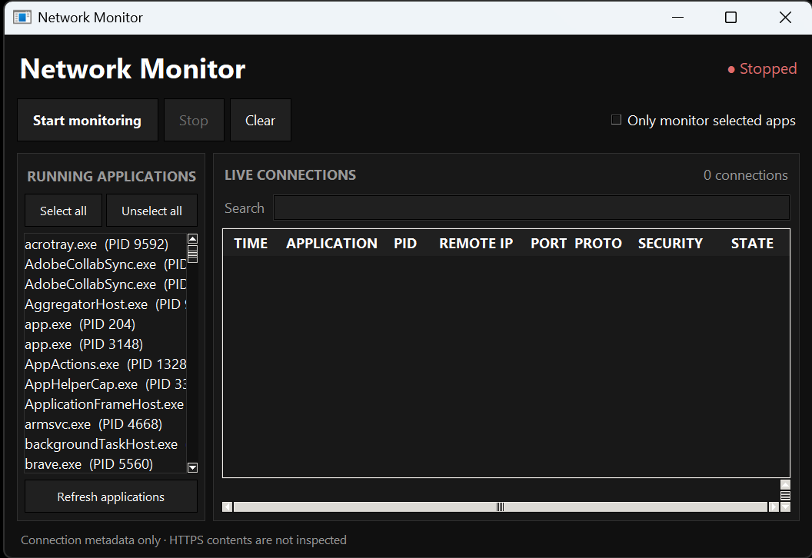

# Network Monitor

very basic network tracker, tracks network requests made by apps

good for checking for malware i guess🤷‍♂️
<p align="center">
  
</p>

## Compile

1. Download and install Python from [python.org](https://www.python.org/downloads/).
2. Open a terminal in this folder and install the requirements:

   ```powershell
   pip install -r requirements.txt
   ```

3. Build the executable:

   ```powershell
   pyinstaller --onefile --windowed --icon=icon.ico --add-data "icon.ico;." app.py
   ```
